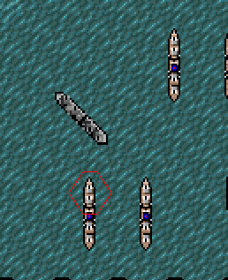
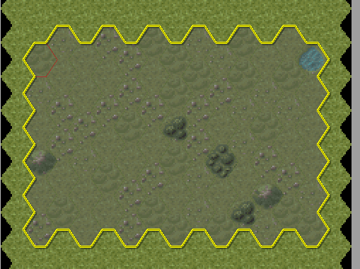
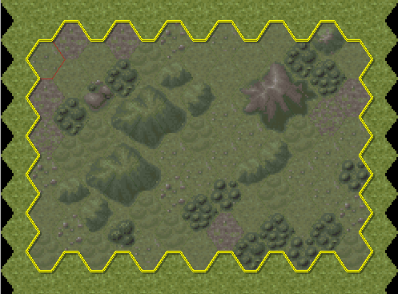
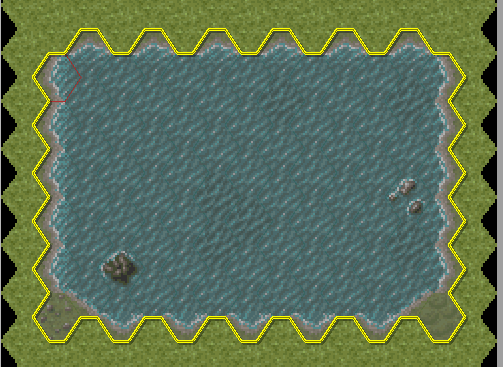

See original [README.md](ORIGINAL_README.md).

# A fork of HL-Editor

A fork of the excellent HL-Editor. The goal is to 

1. Make a full-featured version that works natively in Linux (completed).

2. Fix some of the known issues (almost completed)

2. Implement new features. By now, the last major task left is implementing undo / redo.

## Done so far

* The core library (fin, Lib, shp, codes etc) is kept (almost) untouched
* By that the internal structure of the application is also the same 
* However, the MainWindow, UX and application flow is (almost) entirely rewritten
  - A convenient Toolbar
  - Dragdrop units, buildings and mountains directly on map
  - Select a part of the map and auto fill with for example 'Dense Forest', 'Wasteland' etc
  - Autogenerate rivers, roads, coast lines etc just by mouse click
  - Improved dialogs for 'New map', 'Resize map'
  - A 'Units overview' which also calculates the strength or value of each side
                                                                                                                     
...And much more! To sum it up: The improvements dramatically speeds up the Map-creation process. 

## New Toolbar

* Have added a toolbar with the most obvious actions, including some new navigation features
* Added zoom-buttons with 0.5 granularity
* Added a 'deselect' button, tile_selection/unit_selection etc is resetted
* Buttons for selection and paths (autogenerate river, roads)

## Dragdrop

 
<small>The mouse cursor is transformed into a BW image of the object being dragged</small>  

* You can drag units directly into buildings and transporters 

* All building types can be dragdropped (HQ, depots, factory, under construction depot)

* Buildings and transporters maintain their inventory after dragdrop

* Also dragdrop mountains including 'hillside'.

* You can only dragdrop 'legit' buildings and mountains. 

## Selection

Select an area of the map and fill it with a themed pattern :

 

* Predefined fills: Plains, Light Forest, Dense Forest, Wasteland, Battlefield, Residental area, Lake and Island. 

* The Editor uses a random engine and a 'race' between different tile types to produce unique 'organic looking'  fills each time. 

* All kind of landscape types can be marked as 'protected', so the fill not overwrite those types. By default, roads, railroads and buildings are protected. 

## Autopath

You can now autogenerate a 'path' from A to B. By path means a dirtroad, road, railroad, river, coastline or trenchline. Simply click somewhere on the map, and draw for example a river to the next point. This feature really saves a lot of time. 

* The engine calculates a legit path in realtime (while moving the mouse) from A to B (if possible)

* All kind of landscape types can be marked as 'Wind path around'. By that, the generated path will wind around for example buildings, forest tiles and bunkers. 

* Different path types available: Classic, 

* 

#### Map, editor

* Paths, autogeneration of various landscape types 
  - Rivers, dirtroads, roads, railroads, trenches, coast lines
  - Experiment with different kind of path generators
  - Automagically insert bridges and crossroads
  - Customise protected areas, let for example a river wind it way around buildings, mountains, forest, bunkers and so on

* Place mountains with right click, select one of the 8 mountain tiles and right click on the map

* Transporters can now only contain same unit types as allowed in the game, unit weight is calculated so they cant break capacity limit

* Ocean type is now stored with the map (.TMP) so resize fill the blanks correct also after reopen

* New menu File -> Recent ..., with a submenu of the last 5 opened maps

* Now show 'open dialog' in 'current directory' i.e. the directory where you last opened a map (so you not need to tracel through directories over and over)

#### Child windows

* Tile and unit windows are now scaled more properly

* You can now set 'Lock Window Tile size', and the child window tile sizes remain the same when You scale (and remembers the preferred scaling)

* Added 'Restore window positions', if checked the mainwindow, tilelist and unitlist opens up in same position and size

* Tile window is now always updated according to summer / winter

* Buildingwindow, now bnuildings and transporters only allow same units as in the game; also transporters weight is calculated so you no accidently exceed their capacity

#### Other

* On new game, bunkers and large ships are now preset as not buildable. Bunkers cannot be set as builable anymore.

* Now autoset zoom as well as Scale_factor upon upstart

* Added 'Autoload recent map', if checked the Editor load recent map at start 

* You can now overwrite a level when adding it (instead of going through 'Remove map from game' first

* Added 'Hide native maps', which on 'Remove map from game'/'Open map by levelcode' hides the native maps (instead of scrolling trough them each time)

* Added a "Unit overview" window, visualization of all units of the map.

#### Code specific

* Sunset the use of `fopen_s` (as mentioned by Knippert in `main.cpp`). That was obvious, I actually needed to find `msvcp140_1.dll` and put it in the HL-Editor main directory, in order to run the EXE with Wine. That should have been fixed.

* Refactored QMessageboxes (and other dialogs) to standalone functions (avoid redundancy). 

* All dialogs should now be centered according to the program position, and be on top of other windows.

* Introduce `dialogs.h` as container for dialogs.

* Introduce `resources.qrc` to include graphics and else in the program file

* Replaced multiple IO calls to .TMP file with a single TMP_Rec struct. Less code and easier to expand.

* Refactored the 'CONFIG.CFG' setup, now using QSettings and INI file format. Less code, easy expandable.

### Whish list, to be implemented if possible and if I am able to figure it out

* Replace map with existing map, so you can play French / winter. This should include a backup, so you can restore the original map.
	
* A "paint" mode, so you dont have to click n times

* Set COM-type in menu instead of last minute option (with reminding popover titles)

* Undo (just last action / click), reload 

* Autosave

* Map annotations: Who did it, story, strategy, preferred level code 

* A "clear all customs maps" function, i.e restore original /MAP

* A more useful overview of all registered maps, also when browsing/loading (I think preload a miniature

 
