See original [README.md](ORIGINAL_README.md).

# A fork of HL-Editor

A fork of the excellent HL-Editor. The goal is to 

1. Make a full-featured version that works natively in Linux (completed).

2. Fix some of the known issues (almost completed)

3. Implement new features. By now, the last major task left is implementing undo / redo.

4. Figure out how to compile to EXE (and perhaps other targets)

## Done so far

* The core library (fin, Lib, shp, codes etc) is kept (almost) untouched
* By that the internal structure of the application is also the same 
* However, the MainWindow, UX and application flow is (almost) entirely rewritten
  - A convenient Toolbar
  - Dragdrop units, buildings and mountains directly on map
  - Select a part of the map and auto fill with for example 'Dense Forest', 'Wasteland' etc
  - Autogenerate rivers, roads, coast lines etc just by mouse click
  - Improved dialogs for 'New map', 'Resize map'
  - A 'Units overview' which also calculates the strength or value of each side
                                                                                                                     
...And much more! To sum it up: The improvements dramatically speeds up the Map-creation process. 

## New Toolbar

* Have added a toolbar with the most obvious actions, including some new navigation features
* Added zoom-buttons with 0.5 granularity
* Added a 'deselect' button, tile_selection/unit_selection etc is resetted
* Buttons for selection and paths (autogenerate river, roads)

## Dragdrop
 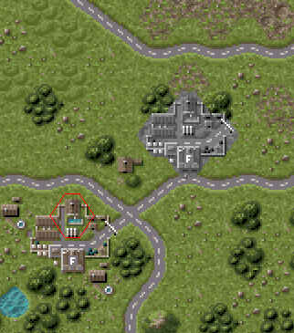 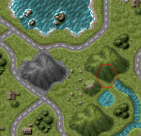 
<small>The mouse cursor is transformed into a BW image of the object being dragged</small>  

* You can drag units directly into buildings and transporters 

* All building types can be dragdropped (HQ, depots, factory, under construction depot)

* Buildings and transporters maintain their inventory after dragdrop

* Also dragdrop mountains including 'hillside'.

* You can only dragdrop 'legit' buildings and mountains. 

## Selection fills

You can now make a selection on the map and fill it with a themed pattern :

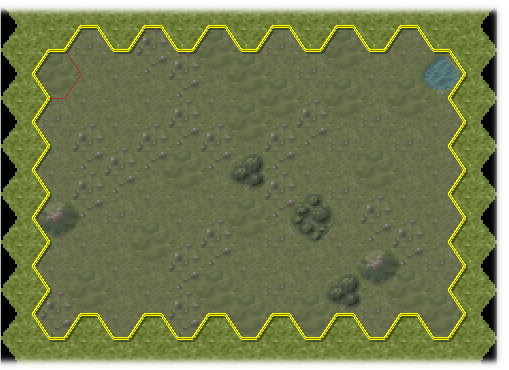 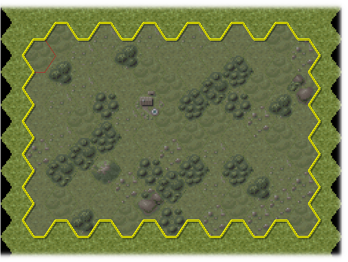 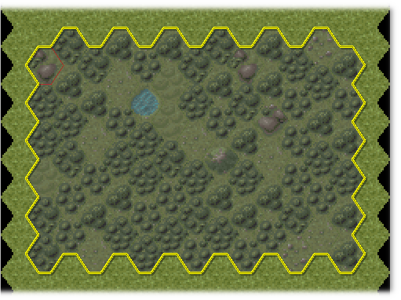

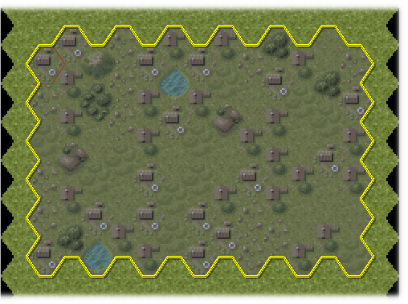 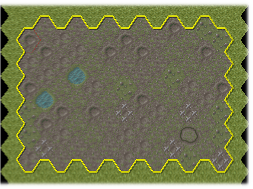 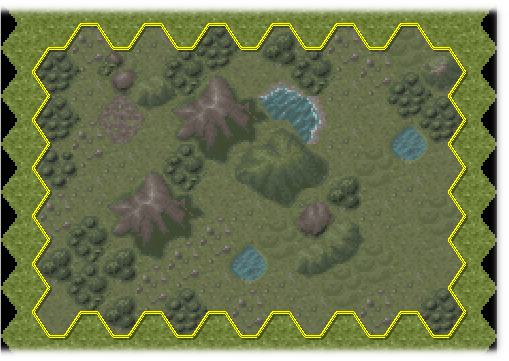

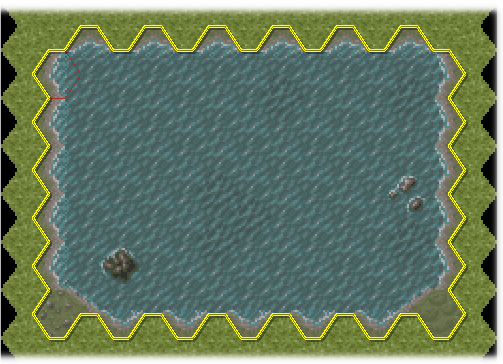 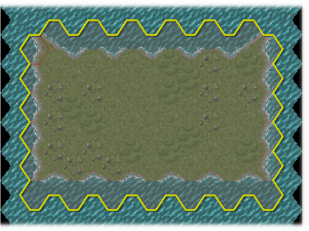
 

* Predefined fills: Plains, Light Forest, Dense Forest, Residentals, Battlefield, Wasteland, Lake and Island. 

* The above samples are just illustrative, patterns are not repeated. The Editor uses a random engine and a 'race' between different tile types to produce unique 'organic looking'  fills each time. 

* All kind of landscape types can be marked as 'protected', so the fill not overwrite those types. By default, roads, railroads and buildings are protected. 

*Experimentally* You can also dragdrop selections, from one part of the map to another - including buildings and units.

## Autopath

You can now autogenerate a 'path' from A to B. By path means a dirtroad, road, railroad, river, coastline or trenchline. Simply click somewhere on the map, and draw for example a river to the next point. This feature really saves a lot of time. 

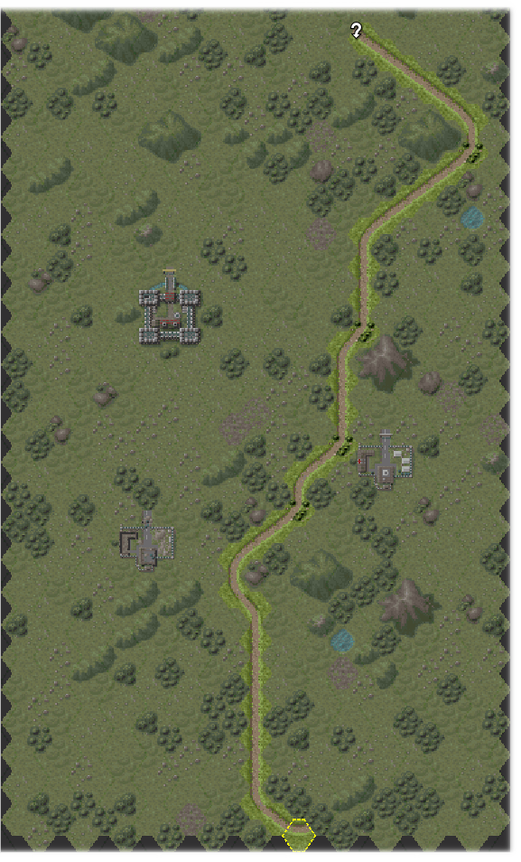 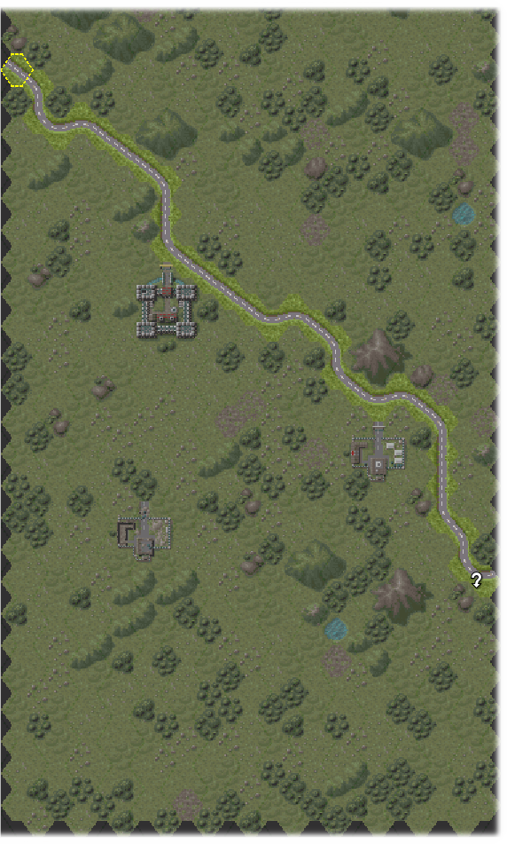 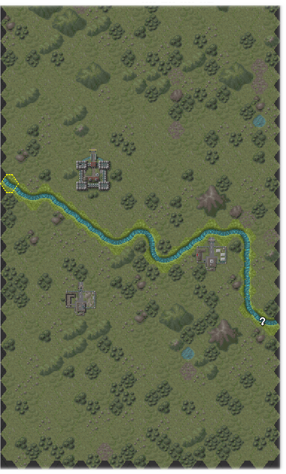 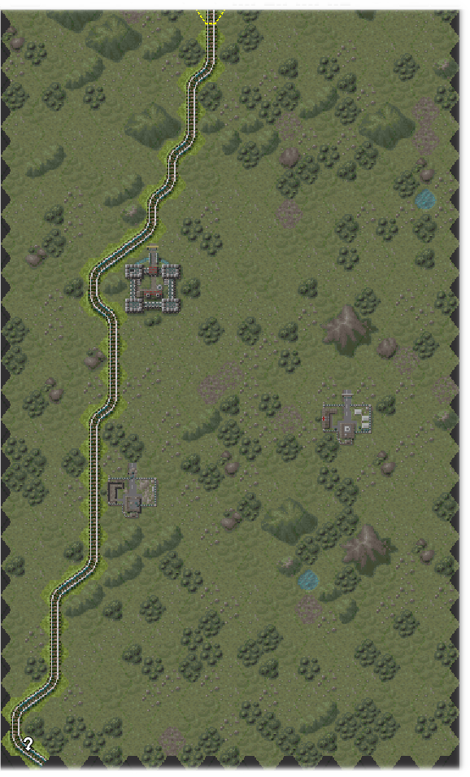

* The engine calculates a legal path through the hexagons in realtime (while moving the mouse) from A to B (if possible). An algorithm calculates the correct HL tiles to insert in the path.

* All kind of landscape types can be marked as 'Wind path around'. By that, the generated path will wind around for example buildings, forest tiles and bunkers. 

* Have experimented a lot with different path types. For example 'Classic' (HL like), 'Straight' (most direct line, both narrow and wide), 'Random' (take short roads) and so on. This will be documented further. 

* Will automagically try to connect to sorrounding tiles of the same type.

* Will insert bridges and crossroads where possible.

## Units overview

Like the original 'Map info' there is now a 'Units overview' for the map. It is a summary of all units on the map, including neutral units, with a calculated 'strenght' or value, i.e the cost in resources if the units should be build in a factory.

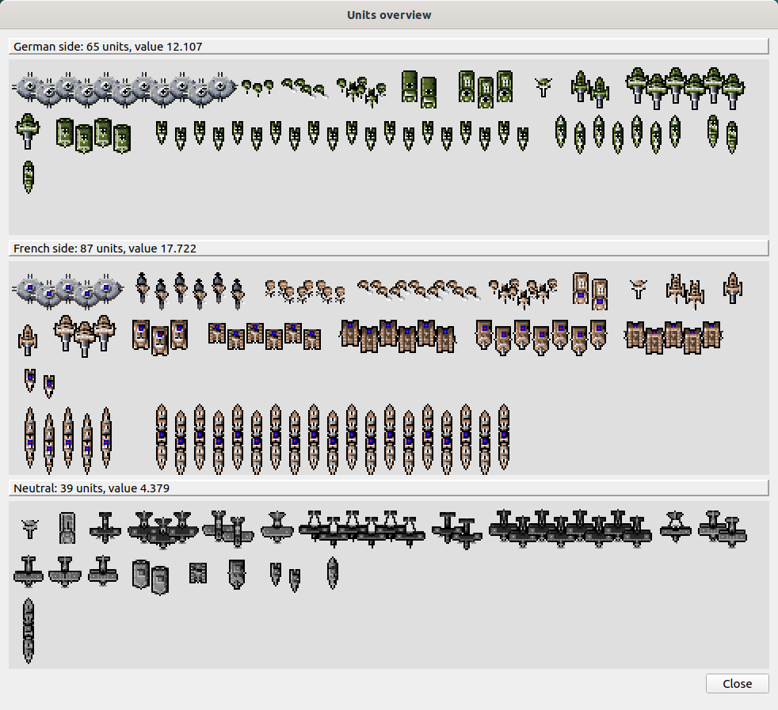 
<small>Here the units from my own ZAHER map</small>

## Resize map

Improved 'Resize map' function,- now you can position (by dragging) the current map to the new map size relatively.

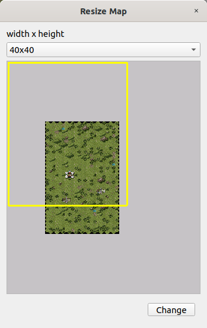 

## New map

Improved 'New map' function, where the options are assembled to one dialog. Besides original plain and ocean fill, you can now pre-fill the map with the same fills as selected areas (Battlefield, Light Forest and so on). 

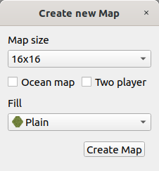 

## Building dialog

You can now cancel / regret any changes made to the building / transporters inventory. If the target is a building, there is a function for safely removal from the map. For transporters the look of the dialog is simplified. 

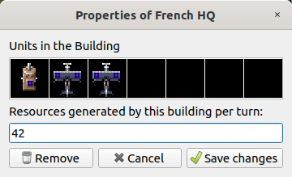 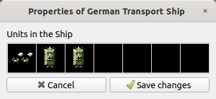 

* Transporters and buildings can now only contain the same unit types as allowed in the game. So no more accidently illegal inventories causing glitches. 

* The weight of the units is now correctly calculated, so you no longer accidently break the max weight limit of a transporter (Supply Car, Supply Train, Transport Ship). 

* These 'sanity checks' also applies when you drag units into a building or a transporter.

* Only 'legit' buildings can be removed, i.e. a building that have all the correct tiles in the correct order.

## Replace tiles

You can now replace multiple tiles until the dialog is closed.  
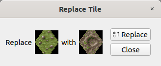 

## Coordinates

Similar to the '*Show grid*' function, hexagon coordinates can now be displayed on the map.  For each hexagon, the <kbd>x</kbd>, <kbd>y</kbd> coordinates are shown along with the internal <kbd>field_pos</kbd>. Coords are automatically turned off if the zoom / Scale_factor is 2.5 or below (too little space).

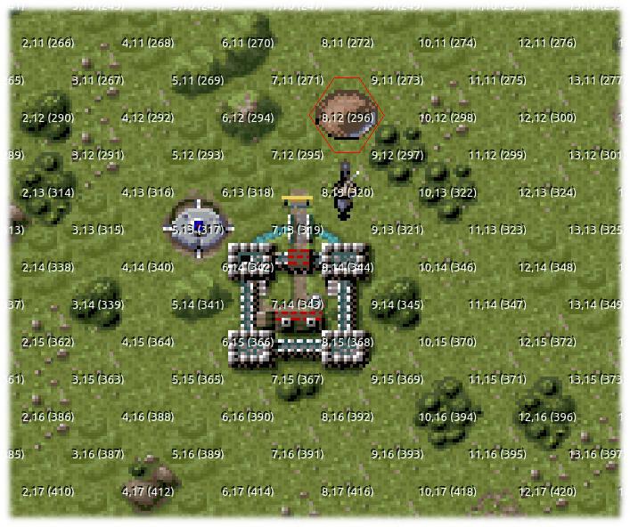

## Buildable units

Bunkers are now effectively blocked from buildable units. It is still present but you can not make it buildable. Also, large ships are by default marked as not buildable (have only effect on new maps). 

## Tilewindow and unitwindow

* Tilewindow and unitwindow are now scaled properly, they follow the current Scale_factor (zoom).

* You can now set 'Lock Window Tile size', and the child window tile sizes remain the same when You scale (and remembers the preferred scaling)

* Added 'Restore window positions', if checked the mainwindow, tilewindow and unitwindow opens up in the exact same position and sizes at startup, including preferred tilesizes.

* The Tilewindow is now always updated correctly according to summer / winter.

* Convenient toolbuttons for quick hide/show the child windows.

## Mountains

As mentioned before you can now drag and drop mountains. You can also autogenerate mountains by selecting one of the 10 mountain tiles and right click on the map. A mountain will be created based on the type of tile you have selected and its order (or position) in the mountain figure. 

## Other improvements worth mention

* Ocean type is now stored with the map (.TMP) so resize fill the blanks correct also after reopen

* New menu File -> Recent ..., with a submenu of the last 5 opened maps

* Now show 'open dialog' in 'current directory' i.e. the directory where you last opened a map (so you not need to tracel through directories over and over)

* Now autoset zoom as well as Scale_factor upon upstart

* Added 'Autoload recent map', if checked the Editor load recent map at start 

* You can now overwrite a level when adding it (instead of going through 'Remove map from game' first)

* Added 'Hide native maps', which on 'Remove map from game'/'Open map by levelcode' hides the native maps (instead of scrolling trough them each time)

## New shortcuts

<table border="0">
<tr><td>
<table>
<tr>
<td><kbd>CTRL O</kbd></td>
<td>Open map</td>
</tr>
<tr>
<td><kbd>CTRL S</kbd></td>
<td>Save map</td>
</tr>
<tr>
<td><kbd>CTRL Q</kbd></td>
<td>Quit</td>
</tr>
<tr>
<td><kbd>CTRL B</kbd></td>
<td>Buildable units</td>
</tr>
<tr>
<td><kbd>CTRL R</kbd></td>
<td>Replace tiles</td>
</tr>
<tr>
<td><kbd>CTRL T</kbd></td>
<td>Toggle Tile selection</td>
</tr>
<tr>
<td><kbd>CTRL U</kbd></td>
<td>Toggle Unit selection</td>
</tr>
</table>
</td>
<td>
<table>
<tr>
<td><kbd>+</kbd></td>
<td>Zoom out</td>
</tr>
<tr>
<td><kbd>-</kbd></td>
<td>Zoom in</td>
</tr>
<tr>
<td><kbd>CTRL G</kbd></td>
<td>Toggle grid</td>
</tr>
<tr>
<td><kbd>CTRL D</kbd></td>
<td>Toggle coords</td>
</tr>
<tr>
<td><kbd>CTRL A</kbd></td>
<td>Select all</td>
</tr>
<tr>
<td><kbd>F1</kbd></td>
<td>Map Info</td>
</tr>
<tr>
<td><kbd>F2</kbd></td>
<td>Units Info</td>
</tr>
</table>
</td>
</table>

## Ideas for future improvement

* Undo / redo (as mentioned above)

* Open dialog with map preview

* Native Maps 'manager' (under development)

